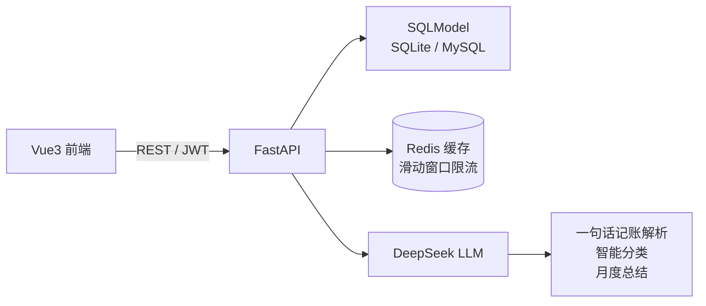

# 大学生记账助手（MoneyMate）

面向**大学生记账场景**的 Python 全栈 Web 应用。支持多钱包、月度预算、生活费规划、统计报表，以及基于大模型的 AI 一句话记账。

**在线演示**：https://money-mate-8vby.onrender.com （演示账号 `demo` / `demo123456`）
> 部署在 Render 免费套餐上，15 分钟无访问会休眠，首次打开需等待数秒唤醒；免费套餐的文件系统不持久，重新部署后数据会重置（每次会重新种入演示数据）。

## 功能

- **注册登录**：注册后自动创建 13 个学生场景默认分类，无需手工配置
- **生活费规划**：设置每月生活费金额与到账日，自动计算「已花 / 剩余 / 日均可用 / 还能撑几天」
- **记一笔**：分类、钱包、金额、备注
- **AI 记账小助手**：输入「今天午饭花了 25」自动识别金额 / 分类 / 钱包，确认后入账
- **AI 智能分类与月度分析**：按分类自动归类，按月聚合生成自然语言消费总结
- **多钱包**：微信、支付宝、现金、银行卡分别记账，各自统计余额
- **统计报表**：分类占比、收支趋势、年度账单报告

## 技术栈

- **后端**：FastAPI · SQLModel（SQLAlchemy 2.x + Pydantic）· SQLite（配 `DATABASE_URL` 即可切 MySQL）· Redis · Uvicorn
- **前端**：Vue3 · TypeScript · Element Plus · ECharts · Pinia · Vite
- **AI**：DeepSeek 大模型（OpenAI 兼容接口），JSON mode 结构化输出 + 流式输出
- **工程化**：pytest（37 项）· Vitest（14 项）· GitHub Actions CI · Docker 多阶段构建 · Render 部署

## 架构



## 快速开始

```bash
python -m venv .venv && source .venv/bin/activate
pip install -r requirements.txt

cp .env.example .env          # 填入 LLM_API_KEY 可开启 AI 功能（不配也能记账）
./start.command
```

Docker：

```bash
docker build -t moneymate .
docker run -p 8000:8000 moneymate
```

## 核心设计

### 1. AI 一句话记账（LLM + Prompt 工程）

设计系统提示词约束 JSON 输出格式，通过 **JSON mode** 让模型把「奶茶 15 元」这类口语化输入解析为 `{金额, 分类, 备注}`，再经 **Pydantic 二次校验**后入库。未配置 API Key 或解析失败时返回 503，前端优雅降级——**AI 功能异常不影响记账主流程**。

### 2. 金额精度

所有金额使用 `Decimal` 而非 `float`，避免浮点误差在累加统计中放大。

### 3. 鉴权与限流

JWT 无状态鉴权 + Argon2 密码哈希；Redis 做热点数据缓存与**滑动窗口限流**。

限流用在 AI 这类成本高的接口上。两个细节：

- **滑动窗口而非固定窗口**：固定窗口把时间切成 `[0,60)`、`[60,120)` 这样的桶，在桶边界两侧各打满一次，任意 60 秒内实际会放过 2×limit 次请求。滑动窗口统计的是「当前时刻往前推 60 秒」，区间连续右移，没有边界突变。
- **原子执行**：判断与计数不能分成「先读再写」两步，否则并发下两个请求会读到同一个旧值、各自 +1 写回，计数少于真实请求数。Redis 侧把「清理过期 + 计数 + 写入」放进一段 Lua 脚本，由 Redis 单线程执行；内存兜底路径用线程锁保护。

Redis 不可用时自动退化为进程内限流，限流组件本身不会成为故障点。

## 测试

```bash
# 后端：27 项接口测试 + 10 项限流测试
pytest tests/ -q

# 前端：api 封装、登录 store、金额格式化
cd frontend && pnpm test
```

限流的 Redis 分支用 `fakeredis` 在进程内真实执行那段 Lua 脚本——本地不一定有 Redis 服务，但它是生产路径，不测等于没跑过。

CI 配置见 `.github/workflows/ci.yml`。

## 评测

AI 功能的效果可以复现地量化，不是靠感觉说「挺好用」。

```bash
# AI 一句话记账：100 条标注测试集，字段级准确率 + 分类混淆 + 追问正确率 + 多笔 + 对抗
.venv/bin/python scripts/eval_ai_parse.py --save

# 先跑几条快速验证
.venv/bin/python scripts/eval_ai_parse.py --limit 10

# 单独测某几条的稳定性（大模型输出有随机性，一次通过不代表稳定通过）
.venv/bin/python scripts/eval_ai_parse.py --only c098 --repeat 5

# 与历史结果对比
.venv/bin/python scripts/eval_ai_parse.py --baseline data/eval/results/2026-10-16_before.json
```

数据集与判分口径：`data/eval/parse_cases.json`（口径写在文件头部，改数据集要同步改口径）。
历次结果：`data/eval/results/`。

三个设计要点：

- 评测走真实接口 `POST /api/ai/parse-transaction`，不是把提示词抄一份到脚本里。抄一份的话，评测能过而线上会挂。
- 准确率拆到字段级（类型 / 金额 / 分类 / 钱包 / 日期）。金额错和日期错是严重程度完全不同的两种错，混成一个「整句准确率」看不出问题在哪。
- 没有明确期望的字段要排除出分母。否则「没评测」会被算成「没通过」，准确率被系统性拉低，看起来像模型的问题，其实是数据集的问题。

脚本需要真实 LLM Key，所以不进 CI；本地改完提示词手动跑。

### 一轮实测结果

改动只有一处：把分类口径写进提示词。原来只给分类名，模型只能凭字面联想，于是「买了瓶水」被判成其他支出、「网费」被判成其他支出。

| 指标 | 改前 | 改后 |
| --- | --- | --- |
| 类型 | 100%（74/74） | 100%（74/74） |
| 金额 | 100%（77/77） | 100%（77/77） |
| 分类 | 91.9%（57/62） | 100%（62/62） |
| 钱包 | 100%（8/8） | 100%（8/8） |
| 日期 | 100%（61/61） | 100%（61/61） |
| 该追问且追问了 | 11/11 | 12/12 |
| 多笔输入命中其中一笔 | 7/10 | 10/10 |
| 对抗样本未被带跑 | 10/10 | 10/10 |

顺带发现两个还没解决的问题，写在说明文档里：多笔输入只返回一笔（需要改接口契约），以及注入抵抗在重复测试下只有 2/3 稳定（靠提示词不可靠）。

## 部署

仓库根目录的 `render.yaml` 已配好 Render Blueprint（Docker、免费套餐、健康检查）。部署步骤见 [说明文档.md](说明文档.md)。

> 关于数据持久化：本地与 Docker Compose 用 SQLite 文件；Render 免费套餐的文件系统不持久，所以线上演示的数据会随重新部署重置。需要长期保存就把 `DATABASE_URL` 指向托管数据库（Postgres / MySQL 均可，代码层只改这一处配置）。

## 目录结构

```
backend/app/
  main.py         应用入口与路由挂载
  config.py       环境变量配置
  constants.py    默认分类等跨模块常量
  models.py       SQLModel 数据模型
  schemas.py      Pydantic 请求/响应模型
  database.py     引擎与会话
  security.py     JWT + Argon2
  cache.py        Redis 缓存（未配置时降级为内存）
  rate_limit.py   滑动窗口限流（Redis 原子执行 + 内存兜底）
  llm.py          DeepSeek 调用封装
  seed_demo.py    演示数据生成
  routers/        auth / wallets / transactions / categories / budget / allowances / stats / ai
frontend/src/
  views/          登录 / 仪表盘 / 流水 / 预算 / 分类 / 年度报告
  stores/         Pinia 状态（登录态持久化）
  components/     布局与图表组件
  *.test.ts       Vitest 单元测试
Dockerfile        唯一的镜像构建文件（render.yaml 与 docker-compose 都指向它）
scripts/
  eval_ai_parse.py    AI 一句话记账的字段级评测
data/eval/
  parse_cases.json    100 条标注测试集与判分口径
  results/            历次评测结果（可做前后对比）
tests/
  conftest.py     测试环境固定（测试库 / 内存缓存 / 不真调模型）
  test_api.py     27 项接口测试
  test_rate_limit.py  10 项限流测试
  test_live.py    对运行中服务的冒烟脚本
```

## License

MIT
