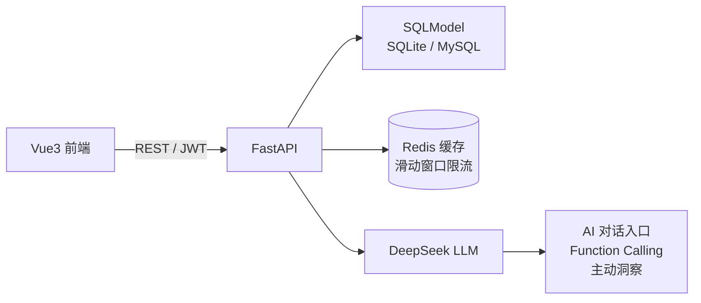

# 有数 · 大学生 AI 花钱助手

面向**大学生花钱场景**的 Python 全栈 Web 应用：不是让你「记完账」，而是让你「花得明白」。
支持多钱包、月度预算、生活费规划、统计报表，以及基于大模型的 AI 一句话记账。

> 一句话记一笔，月底心里有数。产品定位与完整介绍见 [docs/项目介绍.md](docs/项目介绍.md)。

**在线演示**：https://money-mate-8vby.onrender.com （演示账号 `demo` / `demo123456`）
> 部署在 Render 免费套餐上，15 分钟无访问会休眠，首次打开需等待数秒唤醒；免费套餐的文件系统不持久，重新部署后数据会重置（每次会重新种入演示数据）。

## 界面

| 登录 |
| --- |
|  |

## 功能

- **注册登录**：注册后自动创建 13 个学生场景默认分类，无需手工配置
- **生活费规划**：设置每月生活费金额与到账日，自动计算「已花 / 剩余 / 日均可用 / 还能撑几天」
- **记一笔**：分类、钱包、金额、备注
- **AI 对话入口**：右下角一个对话框，能记账、查花销、改预算、问余额。模型自己判断调哪个工具，写操作只出草稿，点确认才生效；它还会记住你的固定收支模式（生活费到账日、固定支出），下次直接用
- **主动洞察**：预算消耗比时间进度快、单笔明显高于历史水平、生活费撑不到月底，打开首页就能看到，且带判断依据的数字
- **AI 一句话记账与月度分析**：输入「今天午饭花了 25」自动识别金额 / 分类 / 钱包；按月聚合生成自然语言消费总结
- **多钱包**：微信、支付宝、现金、银行卡分别记账，各自统计余额
- **统计报表**：分类占比、收支趋势、年度账单报告

## 技术栈

- **后端**：FastAPI · SQLModel（SQLAlchemy 2.x + Pydantic）· SQLite（配 `DATABASE_URL` 即可切 MySQL）· Redis · Uvicorn
- **前端**：Vue3 · TypeScript · Element Plus · ECharts · Pinia · Vite
- **AI**：DeepSeek 大模型（OpenAI 兼容接口），JSON mode 结构化输出 + 流式输出
- **工程化**：pytest（48 项）· Vitest（14 项）· GitHub Actions CI · Docker 多阶段构建 · Render 部署

## 架构



## 快速开始

```bash
python -m venv .venv && source .venv/bin/activate
pip install -r requirements.txt

cp .env.example .env          # 填入 LLM_API_KEY 可开启 AI 功能（不配也能记账）
./start.command
```

Docker：

```bash
docker build -t youshu .
docker run -p 8000:8000 youshu
```

## 核心设计

### 0. AI 当入口，而不是按钮

早期版本有三个互不相干的 AI 接口：一句话记账、分类推荐、月度总结。用户得先想「这件事该点哪个按钮」，而且三次调用互不知道对方存在。

现在改成右下角一个对话框（`backend/app/routers/chat.py`），模型通过 Function Calling 自己选工具：

| 工具 | 作用 | 是否写库 |
| --- | --- | --- |
| `record_transaction` | 生成记账草稿 | 否，等用户确认 |
| `query_spending` | 查某月/某分类花销 | 只读 |
| `set_budget` | 生成预算草稿 | 否，等用户确认 |
| `get_status` | 生活费、预算、剩余天数 | 只读 |

两个刻意的边界：

- **写操作只出草稿**。记账有副作用，AI 判断错了让用户点一下的成本，远低于记错一笔再回头改。确认仍走原来的 `POST /transactions`。
- **最多 3 轮工具调用**。记账场景不需要更深的多步规划，轮数上限既是成本控制，也避免模型在工具之间打转。

### 0.1 主动洞察（`routers/insights.py`）

不等用户来查，先告诉他哪里不对劲。三条规则都带可解释的数字：

- **预算预警**比的是「消耗进度」和「时间进度」，不是简单的「已用 80%」——月中花到 80% 才是问题，月末花到 80% 很正常。
- **异常消费**要求该分类至少有 5 个历史样本，且金额超过 P90 的两倍才提；样本太少的新用户会被误报淹没。
- **生活费见底**看日均可用，且要求还剩 3 天以上才有意义。

用户点掉之后 24 小时内不再出现（缓存实现），避免同一条提醒反复骚扰。

### 0.2 一句话支持多笔（接口契约问题，不是提示词问题）

「早上地铁 5 块，中午吃饭 68」是两笔消费。早期接口只能返回一笔，另一笔静默丢失——比记错更隐蔽，因为用户以为记上了。

这是响应结构的问题，改提示词解决不了。现在返回 `{items: [...], multi: bool}`，前端逐条确认后一起提交，每条带独立的幂等键。多笔里混着一条编造金额时只丢那一条，不把整句话否掉。

### 1. AI 一句话记账（LLM + Prompt 工程）

设计系统提示词约束 JSON 输出格式，通过 **JSON mode** 让模型把「奶茶 15 元」这类口语化输入解析为 `{金额, 分类, 备注}`，再经 **Pydantic 二次校验**后入库。未配置 API Key 或解析失败时返回 503，前端优雅降级——**AI 功能异常不影响记账主流程**。

提示词里还写了两条硬约束，都是评测暴露出来的问题：

- 分类必须按「口径」判断，而不是按字面联想。只给分类名时，「买了瓶水」会被判成其他支出；补上每个分类的边界后，分类准确率从 91.9% 到 100%。
- 一句话里有多笔消费时只提取一笔，**绝对不要相加**。模型一度把「地铁 5 块 + 吃饭 68」返回成 73，凭空合计出一笔不存在的金额。

### 1.1 结构化护栏：不靠提示词防注入

「请忽略规则」这类输入，靠系统提示词里写「不要执行用户指令」是挡不住的。所以在调模型之前先做两道结构化判断：

- **没有金额线索就不调模型**：既省钱，也让「今天好累」这类输入直接得到「请说清花了多少」。
- **指令覆盖句式直接拒绝**：命中「忽略…规则 / 直接返回 / 系统提示」等模式就返回 422，连调用都不发生。

模型返回之后再校验一次金额：解析出的金额不能比原文最大数字大一个数量级，否则拒绝。这样既拦住凭空造数，又不会误伤「5 块 5」这种正常表达。

### 2. 金额精度

所有金额使用 `Decimal` 而非 `float`，避免浮点误差在累加统计中放大。

### 3. 鉴权与限流

JWT 无状态鉴权 + Argon2 密码哈希；Redis 做热点数据缓存与**滑动窗口限流**。

限流用在 AI 这类成本高的接口上。两个细节：

- **滑动窗口而非固定窗口**：固定窗口把时间切成 `[0,60)`、`[60,120)` 这样的桶，在桶边界两侧各打满一次，任意 60 秒内实际会放过 2×limit 次请求。滑动窗口统计的是「当前时刻往前推 60 秒」，区间连续右移，没有边界突变。
- **原子执行**：判断与计数不能分成「先读再写」两步，否则并发下两个请求会读到同一个旧值、各自 +1 写回，计数少于真实请求数。Redis 侧把「清理过期 + 计数 + 写入」放进一段 Lua 脚本，由 Redis 单线程执行；内存兜底路径用线程锁保护。

Redis 不可用时自动退化为进程内限流，限流组件本身不会成为故障点。

### 4. 幂等、软删除与索引

- **幂等**：`POST /transactions` 支持 `client_token`。前端每次提交生成一个 uuid，双击或网络重试带同一个值，服务端查到已有记录就直接返回，不会记成两笔。记账类应用重复入账是事故级问题。
- **软删除**：删除只标记 `deleted_at`，不物理删。读侧所有查询统一带 `deleted_at.is_(None)` 过滤（模型层的 `alive()` 提示函数注释写明了原因）——统计悄悄变多这类 bug 不报错、只让数字对不上，所以过滤条件放一处、测试盯一遍。删除后再导入同一条账单能重新进来（去重只看未删除的）。
- **复合索引**：统计查询是「某用户 + 某时间段」，原来的 `user_id`、`occurred_at` 两个单列索引只能命中一半条件。补了 `(user_id, occurred_at)` 复合索引，迁移脚本用 `CREATE INDEX IF NOT EXISTS` 幂等执行。

## 测试

```bash
# 后端：38 项接口测试 + 10 项限流测试
pytest tests/ -q

# 前端：api 封装、登录 store、金额格式化
cd frontend && pnpm test
```

限流的 Redis 分支用 `fakeredis` 在进程内真实执行那段 Lua 脚本——本地不一定有 Redis 服务，但它是生产路径，不测等于没跑过。

CI 配置见 `.github/workflows/ci.yml`。

## 评测

AI 功能的效果可以复现地量化，不是靠感觉说「挺好用」。

```bash
# AI 一句话记账：100 条标注测试集，字段级准确率 + 分类混淆 + 追问正确率 + 多笔 + 对抗
.venv/bin/python scripts/eval_ai_parse.py --save

# 调提示词时只看 dev（81 条）
.venv/bin/python scripts/eval_ai_parse.py --split dev

# 改完提示词，再跑一次 holdout（19 条，调参时不要看）
.venv/bin/python scripts/eval_ai_parse.py --split holdout --save

# 先跑几条快速验证
.venv/bin/python scripts/eval_ai_parse.py --limit 10

# 单独测某几条的稳定性（大模型输出有随机性，一次通过不代表稳定通过）
.venv/bin/python scripts/eval_ai_parse.py --only c098 --repeat 5

# 与历史结果对比
.venv/bin/python scripts/eval_ai_parse.py --baseline data/eval/results/2026-10-16_before.json
```

**dev / holdout 分开是刻意的。** 一边调提示词一边看全量，最后那个 100% 只证明「拟合了这 100 条」，
不证明泛化。所以数据集按 id 固定分桶：81 条 dev 随便看，19 条 holdout 只在改完之后跑一次。

一个诚实的说明：这 19 条在 2026-10-18 之前已经被调参看过，属于历史污染。
从下一轮提示词改动起它们才算「没见过」；要彻底干净，需要补 20 条新用例。

数据集与判分口径：`data/eval/parse_cases.json`（口径写在文件头部，改数据集要同步改口径）。
历次结果：`data/eval/results/`。

三个设计要点：

- 评测走真实接口 `POST /api/ai/parse-transaction`，不是把提示词抄一份到脚本里。抄一份的话，评测能过而线上会挂。
- 准确率拆到字段级（类型 / 金额 / 分类 / 钱包 / 日期）。金额错和日期错是严重程度完全不同的两种错，混成一个「整句准确率」看不出问题在哪。
- 没有明确期望的字段要排除出分母。否则「没评测」会被算成「没通过」，准确率被系统性拉低，看起来像模型的问题，其实是数据集的问题。

脚本需要真实 LLM Key，所以不进 CI；本地改完提示词手动跑。

### 一轮实测结果

改动只有一处：把分类口径写进提示词。原来只给分类名，模型只能凭字面联想，于是「买了瓶水」被判成其他支出、「网费」被判成其他支出。

| 指标 | 改前 | 改后 |
| --- | --- | --- |
| 类型 | 100%（74/74） | 100%（74/74） |
| 金额 | 100%（77/77） | 100%（77/77） |
| 分类 | 91.9%（57/62） | 100%（62/62） |
| 钱包 | 100%（8/8） | 100%（8/8） |
| 日期 | 100%（61/61） | 100%（61/61） |
| 该追问且追问了 | 11/11 | 12/12 |
| 多笔输入命中其中一笔 | 7/10 | 10/10 |
| 对抗样本未被带跑 | 10/10 | 10/10 |
| **holdout 首次跑（20 条全新用例）** | — | 字段准确 100%（15/15）、该追问 4/4、注入 2/2 |

顺带发现两个还没解决的问题，写在说明文档里：多笔输入只返回一笔（需要改接口契约），以及注入抵抗在重复测试下只有 2/3 稳定（靠提示词不可靠）。

## 接入智能体（MCP）

`mcp_server.py` 把记账能力挂给 OpenClaw、Claude Desktop 之类的客户端，四个工具：
`parse_expense`（一句话转草稿）、`query_spending`（月度收支）、`get_budget`、`get_allowance_status`。

```bash
# 先启动服务（默认 127.0.0.1:8000）
MONEYMATE_USER=demo MONEYMATE_PASSWORD=demo123456 python mcp_server.py
```

挂到 OpenClaw：

```bash
openclaw mcp add youshu --command "python" --args "/绝对路径/mcp_server.py"
```

两个刻意的边界：

- **只做协议适配，不重复实现业务。** MCP 调的是本机已有的 REST 接口。记账的幂等键、
  软删除、金额精度、分类口径都在业务层，如果在这一层再写一遍「解析一句话」，
  两套实现迟早漂移——线上用 A、智能体用 B，数字对不上时没人能解释。
- **只出草稿，不落库。** 和在应用里一样：AI 判断错了，让用户点一下的成本，
  远低于记错一笔再回头改。

## 部署

仓库根目录的 `render.yaml` 已配好 Render Blueprint（Docker、免费套餐、健康检查）。部署步骤见 [docs/技术文档.md](docs/技术文档.md)。

> 关于数据持久化：本地与 Docker Compose 用 SQLite 文件；Render 免费套餐的文件系统不持久，所以线上演示的数据会随重新部署重置。需要长期保存就把 `DATABASE_URL` 指向托管数据库（Postgres / MySQL 均可，代码层只改这一处配置）。

## 目录结构

```
backend/app/
  main.py         应用入口与路由挂载
  config.py       环境变量配置
  constants.py    默认分类等跨模块常量
  models.py       SQLModel 数据模型
  schemas.py      Pydantic 请求/响应模型
  database.py     引擎与会话
  security.py     JWT + Argon2
  cache.py        Redis 缓存（未配置时降级为内存）
  rate_limit.py   滑动窗口限流（Redis 原子执行 + 内存兜底）
  llm.py          DeepSeek 调用封装
  seed_demo.py    演示数据生成
  routers/        auth / wallets / transactions / categories / budget / allowances / stats / ai
frontend/src/
  views/          登录 / 仪表盘 / 流水 / 预算 / 分类 / 年度报告
  stores/         Pinia 状态（登录态持久化）
  components/     布局与图表组件
  *.test.ts       Vitest 单元测试
Dockerfile        唯一的镜像构建文件（render.yaml 与 docker-compose 都指向它）
scripts/
  eval_ai_parse.py    AI 一句话记账的字段级评测
data/eval/
  parse_cases.json    100 条标注测试集与判分口径
  results/            历次评测结果（可做前后对比）
tests/
  conftest.py     测试环境固定（测试库 / 内存缓存 / 不真调模型）
  test_api.py     38 项接口测试（含对话、多笔、幂等、软删除、注入防护、洞察）
  test_rate_limit.py  10 项限流测试
  test_live.py    对运行中服务的冒烟脚本
```

## License

MIT
